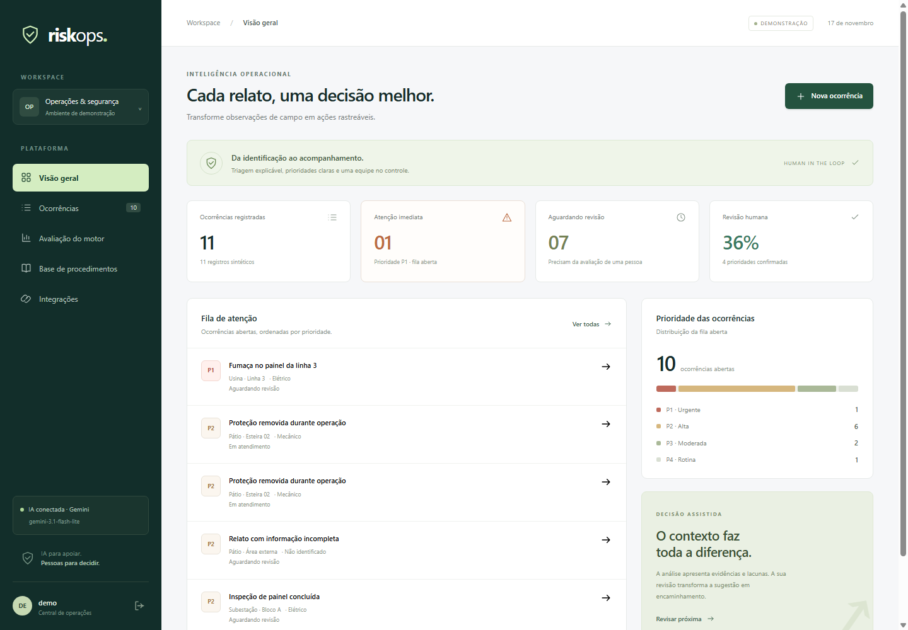

# RiskOps

**Triagem assistida de ocorrências operacionais, da observação à revisão humana.**

Relatos de campo chegam em texto livre. RiskOps organiza o relato em perigos, evidências e informações ausentes, sugere uma prioridade de atendimento e permite que um responsável confirme ou corrija o encaminhamento. O foco é demonstrar uma solução completa de negócio com IA e rastreabilidade.

Protótipo de portfólio de **João Vitor Silva**, inspirado na experiência com automação e desenvolvimento de aplicações. Não é um produto da Vale, não utiliza seus dados e não foi validado para decisões reais de segurança.

**[Demonstração em vídeo — 93 segundos, sem áudio](docs/demo/riskops.webm)** · [Resultados e limitações](evaluation/REPORT.md) · [Arquitetura](docs/ARCHITECTURE.md)

O vídeo registra interações reais com Gemini e entrega assinada ao receptor local, usando apenas dados sintéticos. Desenvolvimento realizado com apoio de IA.



## O que funciona

- Interface responsiva com visão geral, fila pesquisável, filtros, detalhes, cadastro, revisão e conclusão.
- Gemini com saída estruturada e OpenAI Responses como alternativa; adaptadores sem SDK adicional.
- Modo offline por regras, explicitamente identificado e sem simular uso de LLM.
- Recuperação **lexical** de sete procedimentos fictícios, com critérios e versão visíveis.
- Validação de JSON, evidências literais e IDs de procedimentos recuperados; heurística de instruções embutidas e piso local de prioridade.
- Autenticação por sessão, proteção CSRF e permissão específica para revisar.
- Relato salvo antes da chamada à IA; falhas preservam a ocorrência para revisão manual e nova tentativa.
- Histórico com cadeia SHA-256 e controle otimista de versão para evitar revisões sobrescritas.
- Outbox transacional, worker, assinatura HMAC, backoff e receptor local com deduplicação.
- Exportação CSV, OpenAPI e avaliação exploratória de 36 cenários sintéticos contra baseline.

## Executar no Windows

Python 3.12+ (desenvolvimento verificado com 3.14). Node é opcional para checar a sintaxe do frontend.

```powershell
python -m venv .venv
.\.venv\Scripts\python -m pip install -r requirements.txt
Copy-Item .env.example .env
.\.venv\Scripts\python manage.py migrate
.\.venv\Scripts\python manage.py seed_demo
.\.venv\Scripts\python manage.py evaluate
.\.venv\Scripts\python manage.py runserver 127.0.0.1:8000
```

Se as dependências já estiverem instaladas, `powershell -ExecutionPolicy Bypass -File tools/start.ps1` prepara banco, demonstração e avaliação e inicia o servidor usando o Python disponível no terminal.

Abra **http://127.0.0.1:8000**. Usuário local: **demo**. Senha inicial: **demo-local-2026**, substituível por `DEMO_PASSWORD` antes de executar o seed pela primeira vez. O seed não redefine a senha de um usuário já existente. Para alterá-la: `python manage.py changepassword demo`.

O `.env` existente na máquina é ignorado pelo Git. Se ele já existir, edite-o em vez de sobrescrevê-lo. O projeto inicia em modo offline por padrão.

## Ativar Gemini

No arquivo `.env` **local**, configure:

```dotenv
AI_PROVIDER=gemini
GEMINI_API_KEY=sua-chave-local
GEMINI_MODEL=gemini-3.1-flash-lite
```

Reinicie o servidor após editar o ambiente. A interface mostrará o provedor e modelo utilizados. Novas ocorrências ou “Analisar novamente” usam o motor configurado; registros antigos preservam a origem da análise.

O relato é enviado à API Google quando esse modo está ativo. Use os exemplos sintéticos; não inclua dados confidenciais. A chave fica no backend. Ausência de chave, timeout, recusa ou saída inválida marcam a análise como indisponível; a ocorrência permanece salva e pode ser revisada manualmente ou analisada novamente. Não há fallback silencioso para regras. O modelo é configurável porque disponibilidade e cota dependem da sua conta.

O cadastro retorna HTTP 201 mesmo quando a análise falha, pois o relato foi registrado. Verifique `analysis_status` (`pending`, `completed`, `failed`) e `analysis_error`. Um registro novo começa com P2 **provisório**, sem classificação automática validada. Se uma pessoa revisar durante a espera pela IA, o resultado posterior preserva a prioridade confirmada por ela. Uma nova análise que falhar mantém a última análise válida visível e exige nova revisão.

Para OpenAI: `AI_PROVIDER=openai`, `OPENAI_API_KEY=...`, `OPENAI_MODEL=gpt-4o-mini`.

Referências dos contratos: [Gemini Structured Outputs](https://ai.google.dev/gemini-api/docs/structured-output) e [OpenAI Structured Outputs](https://developers.openai.com/api/docs/guides/structured-outputs).

## Demonstrar o alerta de ponta a ponta

Adicione ao `.env`:

```dotenv
WEBHOOK_URL=http://127.0.0.1:9001/alerts
WEBHOOK_SECRET=um-segredo-local-aleatorio
WEBHOOK_ALLOW_LOCAL=true
```

Em outro terminal:

```powershell
python tools/webhook_receiver.py
```

Em um terceiro terminal:

```powershell
python manage.py deliver_alerts --watch
```

Registre uma ocorrência P1. Veja o evento em **Integrações** e os recebimentos em **http://127.0.0.1:9001/receipts**. Atualize a página após a entrega. Sem receptor configurado, eventos ficam pendentes, nunca são marcados como entregues. Webhooks externos exigem HTTPS e segredo; o receptor precisa verificar assinatura, timestamp e deduplicar IDs. O formato é descrito em [Arquitetura](docs/ARCHITECTURE.md).

## Avaliar e testar

```powershell
python manage.py test risk
python manage.py check
python manage.py verify_audit
node --check static/app.js
python manage.py evaluate
# Faz chamadas reais e pode consumir cota:
python manage.py evaluate --provider gemini
# Com o servidor já iniciado e Gemini configurado (cria registro sintético):
python tools/smoke_live.py
```

O painel **Avaliação do motor** lê `evaluation/results.json`. A execução padrão compara baseline com **regras locais**; ela não mede Gemini. As métricas incluem acurácia de prioridade, P1 subestimados, falhas do provedor, mediana de latência, matriz de confusão e resultado por cenário.

A execução real documentada está em [reference-gemini.json](evaluation/reference-gemini.json), e a referência local em [reference-rules.json](evaluation/reference-rules.json). Elas são registros históricos reproduzíveis a partir dos casos, não resultados de uma nova execução na máquina de quem clonou o repositório.

Os 36 casos são sintéticos e públicos, com rótulos definidos pelo autor sem validação especializada. Os cenários estavam disponíveis durante o desenvolvimento; não constituem um teste independente. Falhas e divergências permanecem nos resultados. Não há alegação de precisão operacional, acidentes evitados ou horas economizadas.

## API

As rotas de negócio exigem sessão autenticada. Escritas exigem o token CSRF obtido por `GET /api/session`; o login retorna um novo token. O schema está em **`/api/schema`**.

| Método | Rota | Uso |
|---|---|---|
| GET | `/api/health` | Disponibilidade |
| GET / POST | `/api/incidents` | Lista com filtros/paginação / registro e análise |
| GET | `/api/incidents/{id}` | Análise, auditoria e alertas |
| POST | `/api/incidents/{id}/review` | Confirma prioridade, justificativa e responsável |
| POST | `/api/incidents/{id}/status` | Transição com justificativa |
| POST | `/api/incidents/{id}/reanalyze` | Nova análise, preservando histórico |
| GET | `/api/dashboard` | Indicadores da fila |
| GET | `/api/policies` | Procedimentos e versão |
| GET | `/api/integrations` | Configuração pública sem segredos e outbox |
| GET | `/api/evaluation` | Resultados da última avaliação |
| GET | `/api/export` | Exportação CSV |

Revisão, transição e nova análise exigem `expected_version`. Requisições obsoletas recebem **409**. Um usuário comum registra e consulta; o grupo “Responsáveis” recebe permissão para revisar. Crie contas adicionais por `python manage.py shell` ou pelo código de gestão do Django; esta versão não inclui uma tela administrativa de usuários.

## Docker e publicação

```powershell
docker compose up --build
```

O Compose é uma demonstração local com dados persistidos em volume e worker separado. Um receptor no host exige endereço acessível ao container, por exemplo `host.docker.internal`, em vez de `127.0.0.1`. O Dockerfile permite servir a aplicação com Gunicorn; para publicar, configure HTTPS/proxy, arquivos estáticos, `RISKOPS_DEBUG=false`, `SECRET_KEY`, `ALLOWED_HOSTS`, `CSRF_TRUSTED_ORIGINS`, contas individuais e volume persistente. O seed é bloqueado fora do modo de desenvolvimento. Não publique a configuração de demonstração como ambiente corporativo.

## Estrutura

```text
config/                 configuração e rotas
risk/providers.py       adaptadores LLM e validação de análise
risk/policies.py        recuperação lexical e regras demonstrativas
risk/services.py        transações, revisão, auditoria e workflow
risk/webhooks.py        entrega, assinatura e retry
risk/tests/             testes de comportamento e integrações simuladas
static/ + templates/    interface sem build e sem dependências externas
evaluation/cases.json   cenários sintéticos e rótulos de referência
tools/                  início rápido e receptor local
docs/                   decisões técnicas e roteiro de demonstração
```

Leia [as decisões e limitações técnicas](docs/ARCHITECTURE.md) e [o roteiro para apresentação](docs/DEMO.md).

Telas adicionais: [revisão com evidências](docs/images/review.png) · [interface em celular](docs/images/mobile.png).
