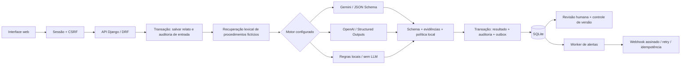

# Decisões de arquitetura

RiskOps é um monólito modular: Django/DRF serve a API, autenticação por sessão e uma interface em JavaScript sem etapa de build. SQLite persiste ocorrências, eventos de auditoria e a caixa de saída. O objetivo é permitir uma demonstração completa e inspecionável em uma máquina, com poucos componentes operacionais.

## Contrato de análise

O motor retorna categoria, severidade potencial, prioridade sugerida, perigos, evidências literais, lacunas, encaminhamentos e procedimentos citados. O servidor valida o JSON, rejeita evidências que não apareçam no relato e rejeita procedimentos que não foram recuperados. Schema correto e citação literal não garantem interpretação correta: essa é uma limitação explícita.

As regras locais podem elevar a urgência sugerida pelo LLM; não a reduzem. Esse piso conservador também pode gerar falsos positivos. A política não é uma matriz SSMA validada e não calcula probabilidade de acidentes. A recuperação é lexical, com termos e ranking visíveis; não é busca semântica nem um RAG com embeddings.

Os prompts separam instruções do relato não confiável. Heurísticas sinalizam comandos embutidos. Isso é defesa em camadas e não uma garantia de resistência a prompt injection. O LLM não tem ferramentas, acesso ao banco ou capacidade de despachar intervenções técnicas.

## Consistência

- A entrada é salva e auditada em uma primeira transação, antes da chamada externa. O registro fica com análise pendente e prioridade P2 provisória. Falhas esperadas do provedor resultam em análise indisponível, com relato preservado para revisão manual. Se o processo terminar inesperadamente durante a chamada, a entrada permanece pendente.
- O resultado da análise, sua auditoria e o eventual alerta são gravados em uma segunda transação. Não há lock de escrita durante a espera pelo provedor.
- Alterações solicitadas por usuários exigem `expected_version`. Um UPDATE condicional incrementa a versão antes de modificar o registro; solicitações obsoletas recebem 409. A conclusão automática serializa sua escrita e preserva uma decisão humana tomada durante a chamada.
- O retorno 201 confirma o cadastro, não o sucesso da IA. O cliente verifica `analysis_status` e `analysis_error`. Análises indisponíveis não são apresentadas como classificações de IA concluídas.
- Revisão humana registra ator, justificativa, responsável e prioridade confirmada. Só uma ocorrência revisada pode ser concluída. Reabertura e nova análise invalidam a revisão anterior.
- Cada evento guarda o hash do evento anterior e um hash SHA-256 do conteúdo. A verificação detecta inconsistências da cadeia, mas alguém com controle total do banco pode reescrevê-la. Não é uma prova externa de imutabilidade.

## Alertas

Somente P1 gera alerta automaticamente. Não é um serviço de emergência. O worker reivindica um evento por UPDATE condicional, usa uma concessão de dois minutos e tenta até cinco vezes com backoff. Um evento abandonado pelo worker pode ser retomado após expirar a concessão.

O payload omite o relato e contém identificador, local e prioridade. O receptor recebe `Idempotency-Key`, `X-RiskOps-Timestamp` e `X-RiskOps-Signature`. A assinatura é `HMAC-SHA256(secret, timestamp + '.' + corpo_original)`. A entrega é **pelo menos uma vez**; receptores precisam persistir IDs para eliminar duplicatas. HTTP 2xx confirma entrega, não a execução de uma ação humana.

Destinos são definidos apenas no ambiente, nunca no relato. HTTP e endereços privados são bloqueados por padrão; a flag local é apenas para desenvolvimento. Redirecionamentos são recusados. Em produção, ainda é necessário controle de saída por rede/allowlist para mitigar, por exemplo, DNS rebinding.

## Limites do protótipo

Autenticação por sessão, permissões de revisão, CSRF, validação de entrada, exportação que neutraliza fórmulas de planilha e renderização de dados via `textContent`/DOM estão implementadas. Throttling e bloqueio de login usam cache local por processo; não são limites globais distribuídos. Para exposição pública: secret própria, HTTPS, contas individuais, cache compartilhado, retenção de dados, política validada por especialistas e processo de resposta operacional são etapas adicionais. A configuração padrão é para localhost.

SQLite atende ao volume de uma demonstração; cargas concorrentes maiores pedem PostgreSQL. O cliente aguarda o LLM de forma síncrona com timeout. Uma falha esperada permite tentar novamente pela interface; entradas pendentes após término abrupto do processo continuam disponíveis para revisão manual, mas a retomada automática da análise ainda não existe. Filas de análise e observabilidade distribuída são evoluções, não funcionalidades presentes. Anexos, imagens e áudios não fazem parte desta versão.
